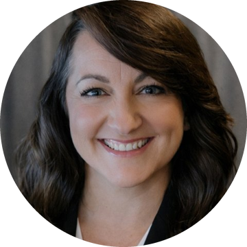

  

  

<h1 align="center">Renee Gelin</h1>

  <b>Business Architect &nbsp;|&nbsp; Business Solutions &amp; Implementation Leader</b> 
  <i>Strategic analysis, business solutions and data integration, from enterprise roadmap to detailed requirements</i> 
  📍 Tampa, Florida · Open to remote roles

  
  
  

---

I design and deliver business solutions, system integrations, and data for financial services, healthcare, professional services, government, and manufacturing organizations. I have been doing this for more than 25 years. My work runs from executive roadmaps and enterprise architecture through process design, requirements, UAT, cutover, training, and change management, and I stay on through go-live.

## Roles I'm pursuing

## How I work: strategy to go-live and everything in between

| Stage | What I deliver |
|---|---|
| **Strategy & Roadmap** | Executive facilitation, multi-year roadmaps, MVP scope, M&A due diligence |
| **Architecture & Integration Solutions** | Systems landscapes, data models, data flows, APIs, CMDB and ERP interfaces |
| **Requirements & Implementation Plans** | As-is / to-be process design, BRDs, user stories, acceptance criteria, traceability |
| **UAT & Operational Readiness** | UAT models and governance, go/no-go sign-off, cutover orchestration, hypercare |
| **Organizational Change Management & Training** | Change frameworks, communications, training materials, knowledge transfer |

---

## Selected work

### Greenfield ServiceNow platform for a global firm
**PwC, via TCS · 2025–present** · **400+ catalog items, record producers, and integrations taken to production**

    

- Wrote end-to-end requirements and process flows for Application Lifecycle Management across Take to Market, Material Change, and Sunset journeys. Co-developed the MVP scope and phased cutover plan.
- Documented the CSDM 5 data model and contributed to the design for CMDB integration and coexistence with legacy systems. Defined the third-party risk assessment integration.
- Built the program-wide UAT model, ran go/no-go for every item, orchestrated cutover, and co-wrote the hypercare operating model.
- Created OCM and end-user training materials.

### Systems architecture & M&A integration
**Cherry Bekaert · 2023–2025** · **The firm's first documented systems architecture**

    

- Built architecture diagrams covering systems, data flows, network, and integrations to support consolidation after acquisitions.
- Created the due-diligence questionnaire for acquisition targets and diagrammed each target's processes and systems to support go/no-go decisions.
- Led a vendor selection across 4 firms and 3 platforms, presented it to the Board, and delivered the website, HubSpot, and SharePoint integration on time and under budget.

### Global Warranty System → Salesforce
**Manitowoc Foodservice · 2012–2015** · **$1M+ saved through the platform migration**

    

- Led architecture, process design, and implementation, then migrated the system to Salesforce.
- Served as Salesforce administrator, covering vendor management, environments, interfaces, data dictionaries, security, and training.
- Implemented Salesforce for the global Key Account team serving McDonald's, YUM! Brands, and other chains.

### International mail settlement
**U.S. Postal Service · 2008–2009** · **One billing and receivables system for 242 countries**

    

- Wrote the 242-page system BRD, including the Oracle gap analysis.
- Mapped data from legacy systems into the new platform and Oracle GL.
- Designed and tested 290+ financial reports to Universal Postal Union specifications.

**Also:** Okta identity and HIPAA-compliant patient portal (Baptist Health South Florida) · 5-year ServiceNow roadmap (via Perficient) · Global data warehouse expansion (Citigroup) · Oracle Financials implementation (Ceridian) · RSA Archer and global tax platforms (PwC) · Zero-defect regulatory web delivery (T. Rowe Price)

---

## Toolkit

**Integrations**  

**Platforms**  

**Data & reporting**  

**Delivery**  

**People & change**  

---

## Beyond work

Founder and President of **Saving Our Sisters (SOS), Inc.**, a national all-volunteer 501(c)(3), since 2011.

  <b>The best way to reach me is <a href="https://www.linkedin.com/in/renee-g-8542993">LinkedIn</a> or email at architecturesolutionzinc@gmail.com</b>

